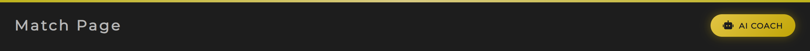
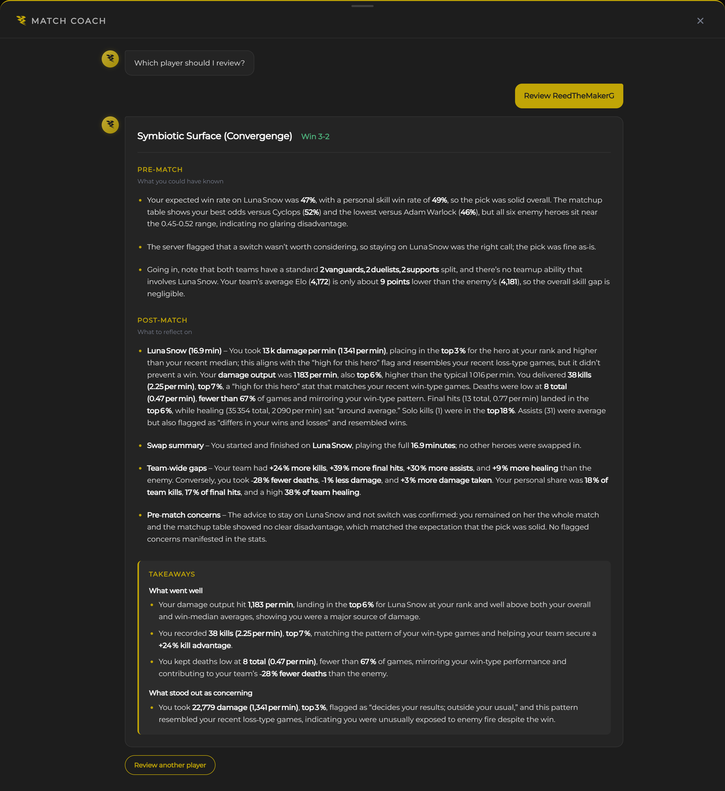

# Rivals Coach Agent

An LLM coaching agent for Marvel Rivals. Given one ranked match and a player, it writes a coaching report: what the player could have known at hero select, what to reflect on after the match, and a few takeaways.

Built with LangGraph, using `openai/gpt-oss-120b` served through Groq. Match data comes from a separate stats backend's `/analysis/*` endpoints.

## Example

The coach opens from a match page:



and writes its report in a chat panel:



## Pipeline

```
fetch_pre → analyze_pre → fetch_post → analyze_post → write_takeaways
```

The pre-match steps only see what was knowable at hero select. The post-match steps add the result and performance, then the last step writes the takeaways.

## Usage

```
python run.py --match <matchId> --player <playerId> [--reasoning low|medium|high]
```

The report is printed and saved, with every step's data, prompt and output, to `runs/<timestamp>-<matchId>/`.
